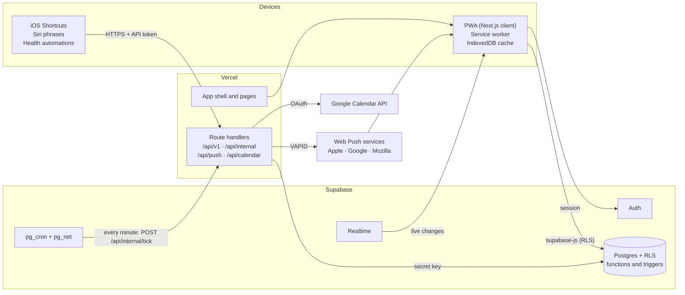
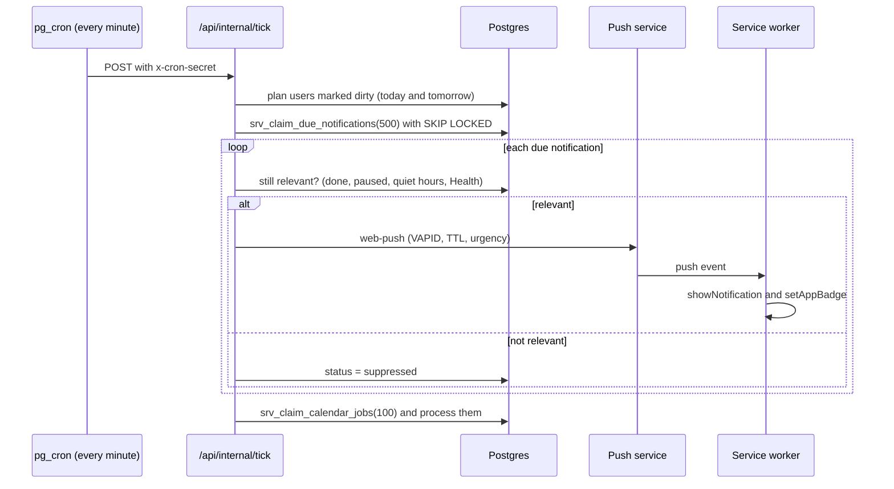

# 03 · Architecture

## 1. Overview



**In one sentence:** the browser reads and writes Supabase directly (protected by RLS) and keeps a local copy for instant UI; Vercel route handlers do only the work that needs secrets (Shortcuts API, push, Google, the scheduler); a `pg_cron` job calls the scheduler every minute.

## 2. Components

| Component | Technology | Responsibility |
|---|---|---|
| Web app | Next.js App Router, React, TypeScript (strict) | UI. Screens are client components that render from the local cache |
| Local data layer | TanStack Query + IndexedDB persistence, supabase-js | Cache, optimistic updates, offline queue, delta sync, Realtime |
| Service worker | Serwist or a hand-written `sw.js` (spike S5) | App-shell caching, offline start, push display, notification clicks |
| Domain module | `src/domain`, pure TypeScript | Habit day, schedules, states, scores, streaks, notification planning (doc 02) |
| Route handlers | Next.js route handlers, Node.js runtime | Shortcuts API, scheduler tick, push sending, Google OAuth and sync, export, account deletion |
| Database | Supabase Postgres | Data, RLS, check-in function, triggers that queue jobs |
| Auth | Supabase Auth | Email one-time code, Google sign-in, sessions |
| Realtime | Supabase Realtime (Postgres changes) | Pushes changes to the user's other open devices |
| Scheduler | Supabase `pg_cron` + `pg_net` | Calls `/api/internal/tick` every minute; nightly cleanup |

**Proposed libraries** (choose versions at setup): Tailwind CSS, shadcn/ui (Radix primitives), lucide-react, Motion, Recharts (charts) with a custom SVG heatmap, dnd-kit (reordering), react-hook-form + zod (forms and API validation), date-fns + `@date-fns/tz` (timezones), next-intl, `@supabase/ssr`, `web-push`. Google APIs are called with plain `fetch` (the `googleapis` package is large).

## 3. Client data flow (local-first)

The goal is that **no user interaction waits for the network**.

1. **Start-up.** The service worker serves the cached app shell. TanStack Query restores its cache from IndexedDB, and Today renders right away from local data. Fresh data is fetched in the background.
2. **Reads.** supabase-js queries, protected by RLS. After the first load, each synced table is fetched incrementally: `updated_at > last cursor`, including soft-deleted rows (`deleted_at`), so deletions reach every device.
3. **What's synced:** profile, categories, routines, habits, habit versions, pauses, check-ins and daily entries for the last 400 days, and weekly reviews. One year of 20 habits is about 7,300 check-ins, which is small.
4. **Check-in writes.** The cache is updated first (optimistic) and the screen changes immediately. The mutation is then queued and persisted, and sent as `rpc('apply_check_in_op')` with a client-generated `op_id`. The server's answer replaces the optimistic row.
5. **Offline.** Queued mutations are kept in IndexedDB and replayed in order when the connection returns. `op_id` makes replays safe (`R-CHK-7`). Increments are sent as amounts, not totals, so a Siri log and an offline tap on the same habit add up correctly.
6. **Other edits** (habits, routines, settings) are upserts with client-generated UUIDs; the last write wins by `updated_at`. Conflicts are rare because one person edits their own data.
7. **Realtime.** The client subscribes to changes on its own `check_ins`, `habits`, `routines`, `pauses` and `daily_entries` and merges them into the cache. A check-in from Siri or Health shows up on an open screen within about a second.
8. **Statistics** are computed on the device with `src/domain` from cached data. If they ever exceed 16 ms, the calculation moves to a Web Worker.

**Why the client talks to Supabase directly** instead of through Next.js server actions: it removes one network hop, RLS already enforces security, and it keeps Vercel function usage low. Route handlers are only used where a secret is needed.

**Side effects run in the database.** Triggers queue jobs (calendar updates, notification re-planning) whenever data changes, no matter if the change came from the app, Siri or Health. See [Data model §4](04-data-model.md#4-triggers).

## 4. Server (route handlers)

| Group | Path | Auth |
|---|---|---|
| Shortcuts API | `/api/v1/*` | Personal access token (`Authorization: Bearer ht_…`) |
| Scheduler | `/api/internal/tick` | Shared secret header from `pg_cron` |
| Push | `/api/push/*` | User session |
| Notification buttons | `/api/notifications/action` | Signed one-time action token |
| Google Calendar | `/api/calendar/google/*` | User session, OAuth `state` |
| Tokens, export, account | `/api/tokens`, `/api/export`, `/api/account` | User session |

All handlers run on the Node.js runtime (`web-push` needs Node's crypto), validate input with zod, and return the error format in [API §1](05-api.md#1-conventions).

After a Siri check-in, the handler uses Next.js `after()` to process the calendar job right away, after the response has been sent. The tick is only a fallback, so the calendar updates within seconds.

## 5. Scheduler

Vercel Cron on the Hobby plan only runs once a day, so the per-minute "tick" comes from Supabase:

```sql
-- runs every minute; calls Vercel only when something is due.
-- The app URL and the secret are read from Supabase Vault.
select cron.schedule('restart-tick', '* * * * *', $$ select public.srv_tick_if_due(); $$);
```

`srv_tick_if_due()` checks, with indexed queries, whether any notification is due, any calendar job is due, or any profile needs planning (`plan_dirty`, or `planned_through` before tomorrow). Only then does it call `net.http_post` to `/api/internal/tick` with the `x-cron-secret` header. With a handful of users, most minutes make no HTTP call at all.



**Tick steps**

1. **Check the secret** with a constant-time comparison.
2. **Plan.** For up to 200 users with `plan_dirty = true` or `planned_through` < their local tomorrow: delete their *pending* notifications from today on, generate new ones for today and tomorrow with `src/domain`, and insert them with `on conflict (dedupe_key) do nothing`. Already-sent notifications keep their `dedupe_key`, so nothing is sent twice.
3. **Send.** Claim due notifications: `send_at ≤ now()`, `status = 'pending'`, locked with `FOR UPDATE SKIP LOCKED`, marked `sending`. For each one, check suppression (`R-NTF-7`), render the text in the user's language, send to every device of the user (20 at a time), and mark it `sent`, `suppressed` or `failed` (up to 2 retries in later ticks).
4. **Calendar.** Claim due `calendar_sync_jobs` and process them with backoff (see [Integrations §3](06-integrations.md#3-google-calendar)).
5. **Time limit.** Stop taking new work after ~30 s. Whatever is left is picked up by the next tick.
6. **Recovery.** Rows stuck in `sending` / `running` for more than 5 minutes go back to `pending`, or become `failed` ("Stuck in sending") once they've used all 3 attempts.

Ticks that overlap are safe because of `SKIP LOCKED`. A second nightly `pg_cron` job runs pure SQL cleanup (see [Data model §6](04-data-model.md#6-retention)).

## 6. Authentication

- **Email one-time code (main method).** `signInWithOtp` with the email template changed to show `{{ .Token }}` (a 6-digit code) instead of a link, then `verifyOtp`. The code is typed inside the installed app, so the session is created in the right place. A magic link would open Safari, which on iOS doesn't share storage with Home Screen apps.
- **Google sign-in.** Supabase's Google provider. Spike S1 checks that it works inside the installed iOS app. If it doesn't, Google sign-in is offered only in the browser.
- **Sessions.** `@supabase/ssr` cookies, refreshed by Next.js middleware.
- **Email delivery.** Supabase's built-in email service is rate-limited and meant for testing. Production uses a custom SMTP provider (e.g. Resend or Postmark).
- **No Sign in with Apple** in v1, because it requires an Apple Developer account.
- **Shortcuts** use personal access tokens ([API §2](05-api.md#2-shortcuts-api-v1)). **Google Calendar** has its own OAuth flow, separate from sign-in, so it works with either sign-in method.

## 7. Internationalization

- **next-intl, without a language prefix in app URLs.** The language comes from the profile, then a cookie, then `Accept-Language`. The public pages (landing, privacy, terms) may use `/es` and `/en` for search engines.
- Message files `messages/es.json` and `messages/en.json` with ICU plurals. Keys are typed, and CI fails if the two files don't have the same keys.
- **Server-generated text** (notifications, Siri replies, calendar name, emails) is translated with the user's profile language.
- **Default content** (routines, categories) has a `system_key` and no `name`. The UI shows the translation of the key until the user renames it, so switching language translates it too (`FR-I18N-4`).
- Dates and numbers use `Intl` with the user's language. The first day of the week comes from the profile.

## 8. PWA

- **Manifest** (`app/manifest.ts`): name, short name, `start_url: "/today"`, `display: "standalone"`, theme and background colors, icons 192/512 plus maskable, and app shortcuts ("Today", "Start morning routine") for Android and desktop.
- **iOS:** `apple-touch-icon`, startup images for the main screen sizes (generated at build), `viewport-fit=cover` and CSS safe-area insets.
- **Service worker:** pre-caches the app shell and static files. Page navigations are network-first with the cached shell as offline fallback. Supabase data is **not** cached by the service worker; it lives in the app's IndexedDB cache.
- **Updates:** when a new service worker is waiting, a toast offers "Update"; accepting activates it and reloads.
- **Push handling:** see [Integrations §4](06-integrations.md#4-web-push).
- **Install guide:** detects the platform. iOS: Share → Add to Home Screen, with pictures. Android and desktop: the browser's install prompt (`beforeinstallprompt`).

## 9. Performance budgets

The brief's "< 100 ms" is read as **what the user perceives**: taps and view changes. Work that has to go over the network has its own budget.

| ID | Metric | Budget | How it's met |
|---|---|---|---|
| NFR-PERF-1 | Tap → visible feedback (check-in, toggle) | ≤ 50 ms p75; INP ≤ 100 ms | Optimistic cache update, no network in the path |
| NFR-PERF-2 | Switch between tabs or views with a warm cache | ≤ 100 ms to content | Client navigation, data from cache, route prefetching |
| NFR-PERF-3 | Cold start of the installed PWA → usable Today | ≤ 1.0 s on a mid-range phone | Cached shell + IndexedDB, no blocking request |
| NFR-PERF-4 | First visit on the web, LCP | ≤ 2.0 s on 4G | Server-rendered shell, small JavaScript |
| NFR-PERF-5 | JavaScript for the Today route (gzip) | ≤ 170 KB | Code splitting; charts loaded only on Stats |
| NFR-PERF-6 | Check-in reaches the server (online) | ≤ 500 ms p95 | One RPC; Vercel and Supabase in the same region |
| NFR-PERF-7 | Shortcuts API server time | ≤ 300 ms p95 | Indexed queries, light dependencies |
| NFR-PERF-8 | Stats for 1 year × 20 habits | ≤ 16 ms | Pure functions; Web Worker if needed |
| NFR-PERF-9 | Reminder leaves the server after `send_at` | ≤ 60 s p95 | Minute tick |

Measured with Vercel Speed Insights (real users), Lighthouse CI on every PR, and Playwright performance marks for NFR-PERF-1 and NFR-PERF-2.

## 10. Security and privacy

- **RLS on every table**, denying by default. Policies are tested in CI with pgTAP.
- The Supabase **secret key** (formerly `service_role`) only exists in server environment variables, never in `NEXT_PUBLIC_*`.
- **API tokens:** 32 random bytes with the prefix `ht_`. Only the SHA-256 hash is stored. The token is shown once, has scopes, can be revoked and records `last_used_at`. Rate limits: 60 requests/min per token and 10 failed attempts/min per IP.
- **Google refresh tokens** are encrypted with AES-256-GCM (key in `TOKEN_ENCRYPTION_KEY`) and only decrypted inside server jobs.
- **Scheduler endpoint:** secret header, compared in constant time. `pg_cron` reads the secret from Supabase Vault.
- **Notification action tokens:** HMAC-SHA256 over `{user, habit, date, action, exp}`, valid for at most 24 h, single use (the `op_id` is derived from the token).
- **Input validation** with zod on every route handler. Database functions check ownership again.
- **Headers:** Content-Security-Policy (self, Supabase, Google OAuth), HSTS, `frame-ancestors 'none'`, a strict `Referrer-Policy`.
- **Health data:** only daily totals of metrics that the user's habits use. Never shared. Can be deleted. Described in the privacy policy.
- **Account deletion** removes everything through `on delete cascade`, and also revokes Google access and push subscriptions.
- **Logs** never contain tokens, emails or Health values.
- Dependabot and GitHub secret scanning on the repository.

## 11. Observability

- Vercel logs and Speed Insights. Error tracking with Sentry on client and server.
- Job tables (`scheduled_notifications`, `calendar_sync_jobs`) keep status, attempts and the last error. An SQL view shows delivery and suppression rates per day.
- Structured logs with a request ID.

## 12. Repository layout

```
.
├── src/
│   ├── app/
│   │   ├── (marketing)/              # landing, privacy, terms (public)
│   │   ├── (auth)/login/
│   │   ├── (app)/                    # signed-in shell: bottom tabs / sidebar
│   │   │   ├── today/
│   │   │   ├── routine/[id]/         # routine mode
│   │   │   ├── habits/               # list, new, [id], [id]/edit
│   │   │   ├── stats/
│   │   │   ├── review/[week]/
│   │   │   └── settings/             # profile, notifications, routines, categories, integrations, data
│   │   ├── api/
│   │   │   ├── v1/                   # Shortcuts API
│   │   │   ├── internal/tick/
│   │   │   ├── push/  notifications/action/
│   │   │   ├── calendar/google/
│   │   │   └── tokens/  export/  account/
│   │   └── manifest.ts
│   ├── domain/                       # pure rules from doc 02 (shared by client and server)
│   ├── data/                         # Supabase clients, query keys, sync, offline queue
│   ├── server/                       # push, planner, dispatcher, calendar, tokens, crypto
│   ├── components/                   # UI built on shadcn/ui
│   ├── i18n/
│   └── lib/
├── messages/                         # es.json, en.json
├── public/                           # icons, startup images, sw.js (if hand-written)
├── supabase/
│   ├── migrations/
│   ├── seed.sql
│   └── tests/                        # pgTAP: RLS and functions
├── shortcuts/                        # step-by-step recipes, screenshots, iCloud links (es, en)
├── tests/e2e/                        # Playwright
└── docs/spec/
```

## 13. Configuration

| Variable | Where | Purpose |
|---|---|---|
| `NEXT_PUBLIC_SUPABASE_URL` | client + server | Supabase project URL |
| `NEXT_PUBLIC_SUPABASE_PUBLISHABLE_KEY` | client + server | Public key, limited by RLS |
| `SUPABASE_SECRET_KEY` | server | Server jobs and Shortcuts API |
| `NEXT_PUBLIC_APP_URL` | client + server | Canonical URL for links, OAuth and push |
| `NEXT_PUBLIC_VAPID_PUBLIC_KEY` · `VAPID_PRIVATE_KEY` · `VAPID_SUBJECT` | client / server | Web Push |
| `CRON_SECRET` | server (+ Supabase Vault) | Protects `/api/internal/tick` |
| `GOOGLE_CLIENT_ID` · `GOOGLE_CLIENT_SECRET` | server | Calendar OAuth |
| `TOKEN_ENCRYPTION_KEY` | server | AES-256-GCM key for Google tokens |
| `ACTION_TOKEN_SECRET` | server | HMAC key for notification buttons |
| `SENTRY_DSN` | client + server | Error tracking |

## 14. Testing and CI/CD

| Layer | Tool | What |
|---|---|---|
| Domain | Vitest | Every example in doc 02, table-driven; time zones and DST; property tests for streaks and scores |
| Database | Supabase CLI + pgTAP | RLS for every table, `apply_check_in_op`, Health rules, claim functions; parity with `src/domain` states |
| API | Vitest + local Supabase | `/api/v1` contracts, auth, rate limits, error format |
| End to end | Playwright | Onboarding, habits, check-ins, offline queue, two devices syncing, both languages |
| Manual | Device checklist | iPhone push, Siri, Health automations, install flow (cannot be automated) |

- **GitHub Actions** on every PR: lint, typecheck, unit tests, database tests, build, Lighthouse CI, and a check that `es`/`en` keys match.
- **Vercel** preview deployment for every PR, pointing at a **staging** Supabase project.
- **Migrations** live in `supabase/migrations` and are applied to staging, then production, with the Supabase CLI from CI after merging to `main`.

## 15. Hosting, regions and cost

- Put Vercel functions and the Supabase project **in the same region**, close to most users (for example São Paulo for both if users are mostly in South America). Each extra region hop adds latency to every check-in.
- **Restart is free and for a small private group** (the owner, family and friends), so the free plans fit: **Vercel Hobby** (personal, non-commercial use) and **Supabase Free**. Moving to Vercel Pro and Supabase Pro is only needed if Restart ever becomes a public or paid product.
- **Supabase Free** pauses projects after a period of inactivity. Daily use by a few people keeps it active; if it ever pauses, it's restored from the dashboard.
- **Keep the tick cheap.** The `pg_cron` job only calls Vercel when there's work due (see §5), so an idle minute costs nothing on Vercel.
- A **custom domain** is optional. It helps email deliverability and makes the Google consent screen look trustworthy, but the `*.vercel.app` domain works.
