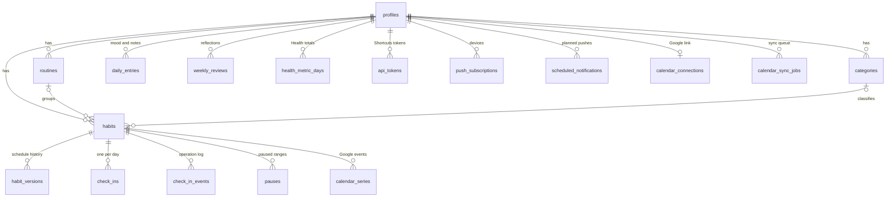

# 04 · Data model

Postgres on Supabase. This is the **target schema** for the first migrations. Once migrations exist in `supabase/migrations/`, they are the source of truth and this document is updated with them.

**Conventions**

- Every user-owned table has `user_id uuid not null references auth.users on delete cascade`, so deleting an account deletes everything.
- Tables synced to the client have `updated_at` (set by a trigger) and `deleted_at` (soft delete), so deletions reach every device. Soft-deleted rows are purged after 30 days.
- IDs are UUIDs. The client can generate them (needed for offline creation).
- Times of day are `time` in the user's timezone. Instants are `timestamptz`. Habit days are `date` (see `R-DAY`).

## 1. Relationships



## 2. Schema

```sql
create extension if not exists pg_trgm;   -- fuzzy habit-name matching for Siri
create extension if not exists unaccent;  -- accent-insensitive matching
create extension if not exists pg_cron;   -- scheduler (enable in the Supabase dashboard)
create extension if not exists pg_net;    -- HTTP calls from pg_cron

create type habit_kind          as enum ('boolean', 'measurable');
create type schedule_type       as enum ('daily', 'days_of_week', 'times_per_week');
create type check_in_status     as enum ('done', 'partial', 'skipped');
create type check_in_source     as enum ('app', 'routine_mode', 'siri', 'notification', 'health', 'import');
create type skip_reason         as enum ('sick', 'travel', 'rest', 'other');
create type health_metric       as enum ('steps', 'exercise_minutes', 'active_energy_kcal', 'distance_km',
                                         'mindful_minutes', 'workouts', 'sleep_hours');
create type notification_kind   as enum ('habit_reminder', 'routine_digest', 'daily_report', 'weekly_review',
                                         'test');  -- 'test': "Send test" button and spike S2
create type notification_status as enum ('pending', 'sending', 'sent', 'suppressed', 'failed');
create type job_status          as enum ('pending', 'running', 'done', 'failed');
```

### 2.1 Profile and settings

```sql
create table profiles (
  id                      uuid primary key references auth.users on delete cascade,
  display_name            text,
  locale                  text not null default 'en' check (locale in ('es', 'en')),  -- English fallback (FR-I18N-2)
  timezone                text not null default 'UTC',            -- IANA name
  day_start_hour          smallint not null default 4 check (day_start_hour between 0 and 6),
  week_start              smallint not null default 1 check (week_start in (1, 7)),  -- ISO: 1 Mon, 7 Sun
  reminder_lead_min       smallint not null default 5 check (reminder_lead_min between 0 and 120),
  daily_report_enabled    boolean not null default true,
  daily_report_time       time not null default '22:00',
  weekly_review_enabled   boolean not null default true,
  weekly_review_dow       smallint not null default 7 check (weekly_review_dow between 1 and 7),
  weekly_review_time      time not null default '19:00',
  quiet_hours_start       time,                                   -- both null = no quiet hours
  quiet_hours_end         time,
  muted_until             timestamptz,                            -- "mute for today"
  retro_edit_days         smallint not null default 7 check (retro_edit_days between 0 and 30),
  max_skips_per_month     smallint not null default 4 check (max_skips_per_month between 0 and 10),
  theme                   text not null default 'system' check (theme in ('system', 'light', 'dark')),
  plan_dirty              boolean not null default true,          -- notifications must be re-planned
  planned_through         date,                                   -- last habit day already planned
  last_health_sync_at     timestamptz,
  onboarding_completed_at timestamptz,
  created_at              timestamptz not null default now(),
  updated_at              timestamptz not null default now()
);
```

### 2.2 Categories, routines, habits

```sql
create table categories (
  id          uuid primary key default gen_random_uuid(),
  user_id     uuid not null references auth.users on delete cascade,
  system_key  text,                 -- 'health', 'fitness', 'mind', … for defaults; null if user-made
  name        text,                 -- null = show translation of system_key
  color       text not null default 'slate',
  icon        text,
  sort_order  int not null default 0,
  created_at  timestamptz not null default now(),
  updated_at  timestamptz not null default now(),
  deleted_at  timestamptz,
  check (system_key is not null or name is not null)
);

create table routines (
  id              uuid primary key default gen_random_uuid(),
  user_id         uuid not null references auth.users on delete cascade,
  system_key      text,             -- 'morning', 'evening' for defaults
  name            text,
  icon            text,
  start_time      time not null,
  end_time        time,
  digest_enabled  boolean not null default true,
  sort_order      int not null default 0,
  created_at      timestamptz not null default now(),
  updated_at      timestamptz not null default now(),
  deleted_at      timestamptz,
  check (system_key is not null or name is not null)
);

create table habits (
  id                 uuid primary key default gen_random_uuid(),
  user_id            uuid not null references auth.users on delete cascade,
  category_id        uuid references categories on delete set null,
  routine_id         uuid references routines on delete set null,   -- null = Anytime
  name               text not null check (char_length(name) between 1 and 80),
  description        text,
  icon               text,
  color              text,
  cue                text,                                           -- "After I brew coffee"
  voice_aliases      text[] not null default '{}',
  kind               habit_kind not null default 'boolean',
  target_value       numeric check (target_value > 0),              -- measurable only
  unit               text,                                           -- 'steps', 'glasses', 'min'
  increment_step     numeric not null default 1 check (increment_step > 0),
  schedule_type      schedule_type not null default 'daily',
  days_of_week       smallint[],                                     -- ISO 1..7
  times_per_week     smallint check (times_per_week between 1 and 7),
  time_of_day        time,                                           -- null = routine start / anytime
  duration_min       smallint check (duration_min between 1 and 600),
  reminder_enabled   boolean not null default true,
  reminder_lead_min  smallint check (reminder_lead_min between 0 and 120),  -- null = profile default
  health_metric      health_metric,                                  -- null = no Health rule
  health_target      numeric check (health_target > 0),
  calendar_sync      boolean not null default false,
  sort_order         int not null default 0,                         -- order inside the routine
  start_date         date not null,                                  -- set by the client (user's today)
  archived_on        date,
  created_at         timestamptz not null default now(),
  updated_at         timestamptz not null default now(),
  deleted_at         timestamptz,
  constraint measurable_has_target check (kind = 'boolean' or target_value is not null),
  constraint schedule_is_consistent check (
       (schedule_type = 'daily')
    or (schedule_type = 'days_of_week'   and cardinality(days_of_week) between 1 and 7
                                         and days_of_week <@ array[1,2,3,4,5,6,7]::smallint[])
    or (schedule_type = 'times_per_week' and times_per_week is not null)),
  constraint health_rule_is_complete check ((health_metric is null) = (health_target is null))
);

-- Schedule history (R-SCHED-0). Written only by a trigger on habits.
create table habit_versions (
  habit_id        uuid not null references habits on delete cascade,
  valid_from      date not null,
  user_id         uuid not null references auth.users on delete cascade,
  schedule_type   schedule_type not null,
  days_of_week    smallint[],
  times_per_week  smallint,
  kind            habit_kind not null,
  target_value    numeric,
  updated_at      timestamptz not null default now(),
  primary key (habit_id, valid_from)
);

create table pauses (
  id          uuid primary key default gen_random_uuid(),
  user_id     uuid not null references auth.users on delete cascade,
  habit_id    uuid references habits on delete cascade,   -- null = all habits (vacation mode)
  start_date  date not null,
  end_date    date,                                        -- inclusive; null = until resumed
  reason      skip_reason,
  created_at  timestamptz not null default now(),
  updated_at  timestamptz not null default now(),
  deleted_at  timestamptz,
  check (end_date is null or end_date >= start_date)
);
```

### 2.3 Check-ins and reflection

```sql
-- Current state: one row per habit and day (R-CHK-1). Written only by apply_check_in_op.
create table check_ins (
  id               uuid primary key default gen_random_uuid(),
  user_id          uuid not null references auth.users on delete cascade,
  habit_id         uuid not null references habits on delete cascade,
  local_date       date not null,
  status           check_in_status not null,
  value            numeric check (value >= 0),             -- measurable progress
  skip_reason      skip_reason,
  note             text,
  source           check_in_source not null,               -- source of the last change
  health_verified  boolean not null default false,
  auto_dismissed   boolean not null default false,         -- user undid a Health completion (R-HLT-3)
  completed_at     timestamptz,
  created_at       timestamptz not null default now(),
  updated_at       timestamptz not null default now(),
  deleted_at       timestamptz,                            -- set by 'clear'; row is reused later
  unique (habit_id, local_date)
);

-- Append-only log: idempotency (R-CHK-7), undo (R-CHK-8) and history.
create table check_in_events (
  op_id       uuid primary key,
  user_id     uuid not null references auth.users on delete cascade,
  habit_id    uuid not null references habits on delete cascade,
  local_date  date not null,
  op          text not null check (op in ('complete', 'increment', 'set_value', 'skip', 'clear',
                                          'set_note', 'health_sync', 'undo')),
  payload     jsonb not null default '{}',
  prev_state  jsonb,                                       -- check-in row before this op, null if none
  source      check_in_source not null,
  undone_at   timestamptz,
  created_at  timestamptz not null default now()
);

create table daily_entries (
  user_id     uuid not null references auth.users on delete cascade,
  local_date  date not null,
  mood        smallint check (mood between 1 and 5),
  note        text,
  updated_at  timestamptz not null default now(),
  deleted_at  timestamptz,
  primary key (user_id, local_date)
);

create table weekly_reviews (
  user_id       uuid not null references auth.users on delete cascade,
  week_start    date not null,
  reflection    text,
  completed_at  timestamptz,
  updated_at    timestamptz not null default now(),
  primary key (user_id, week_start)
);
```

### 2.4 Integrations

```sql
-- Apple Health daily totals (R-HLT-2). Only metrics used by the user's habits are kept.
create table health_metric_days (
  user_id     uuid not null references auth.users on delete cascade,
  metric      health_metric not null,
  local_date  date not null,                               -- calendar date as reported by Health
  value       numeric not null check (value >= 0),
  synced_at   timestamptz not null default now(),
  primary key (user_id, metric, local_date)
);

-- Personal access tokens for Shortcuts.
create table api_tokens (
  id            uuid primary key default gen_random_uuid(),
  user_id       uuid not null references auth.users on delete cascade,
  name          text not null,                             -- "My iPhone"
  token_prefix  text not null,                             -- first 8 chars, for display
  token_hash    bytea not null unique,                     -- sha256(token)
  scopes        text[] not null default '{habits:read,checkins:write,health:write}',
  last_used_at  timestamptz,
  created_at    timestamptz not null default now(),
  revoked_at    timestamptz
);

create table push_subscriptions (
  id               uuid primary key default gen_random_uuid(),
  user_id          uuid not null references auth.users on delete cascade,
  endpoint         text not null unique,
  p256dh           text not null,
  auth             text not null,
  platform         text,                                   -- 'ios', 'android', 'desktop'
  device_label     text,                                   -- "iPhone · Safari"
  created_at       timestamptz not null default now(),
  last_success_at  timestamptz,
  failure_count    smallint not null default 0
);

create table scheduled_notifications (
  id                 bigint generated always as identity primary key,
  user_id            uuid not null references auth.users on delete cascade,
  kind               notification_kind not null,
  habit_id           uuid references habits on delete cascade,     -- FK added in Phase 1 (habits don't exist in Phase 0)
  routine_id         uuid references routines on delete cascade,   -- FK added in Phase 1
  local_date         date not null,
  send_at            timestamptz not null,
  status             notification_status not null default 'pending',
  suppressed_reason  text,
  attempts           smallint not null default 0,
  last_error         text,
  claimed_at         timestamptz,                          -- set when a tick claims it; stuck rows are reset
  sent_at            timestamptz,
  dedupe_key         text not null unique,   -- e.g. 'habit_reminder:<habit>:2026-10-20', snoozes add ':snooze:<n>'
  created_at         timestamptz not null default now()
);

create table calendar_connections (
  user_id            uuid primary key references auth.users on delete cascade,
  provider           text not null default 'google',
  google_email       text,
  calendar_id        text,                                 -- the app's own "Habits" calendar
  refresh_token_enc  bytea not null,                       -- AES-256-GCM
  status             text not null default 'active' check (status in ('active', 'needs_reauth', 'disconnected')),
  connected_at       timestamptz not null default now(),
  updated_at         timestamptz not null default now()
);

-- One Google recurring event per habit and schedule period (series are split on schedule changes).
create table calendar_series (
  id               uuid primary key default gen_random_uuid(),
  user_id          uuid not null references auth.users on delete cascade,
  habit_id         uuid not null references habits on delete cascade,
  google_event_id  text not null,
  valid_from       date not null,
  valid_until      date,
  rrule            text not null,
  created_at       timestamptz not null default now(),
  updated_at       timestamptz not null default now()
);

create table calendar_sync_jobs (
  id               bigint generated always as identity primary key,
  user_id          uuid not null references auth.users on delete cascade,
  habit_id         uuid,                                   -- no FK: delete jobs outlive the habit
  local_date       date,
  op               text not null check (op in ('sync_series', 'end_series', 'delete_series',
                                                 'mark_instance', 'full_resync', 'delete_calendar')),
  payload          jsonb not null default '{}',            -- e.g. Google event IDs for delete_series
  status           job_status not null default 'pending',
  attempts         smallint not null default 0,
  next_attempt_at  timestamptz not null default now(),
  last_error       text,
  created_at       timestamptz not null default now()
);

-- Fixed-window rate limiting for /api/v1 (could move to Redis later).
create unlogged table rate_limits (
  key           text not null,                             -- 'token:<id>' or 'ip:<addr>'
  window_start  timestamptz not null,
  hits          int not null default 0,
  primary key (key, window_start)
);
```

## 3. Row Level Security

RLS is enabled on **every** table. The common policy uses `(select auth.uid())` so Postgres evaluates it once per query:

```sql
alter table habits enable row level security;
create policy "own rows" on habits
  for all to authenticated
  using      (user_id = (select auth.uid()))
  with check (user_id = (select auth.uid()));
```

| Table | `authenticated` users can | Notes |
|---|---|---|
| `profiles` | select, update own (`id = auth.uid()`) | Insert by signup trigger. `plan_dirty`, `planned_through`, `last_health_sync_at` are only set by triggers and server code |
| `categories`, `routines`, `habits`, `pauses`, `daily_entries`, `weekly_reviews` | all operations on own rows | |
| `habit_versions` | select own | Written by trigger |
| `check_ins` | select own | Written only through `apply_check_in_op` (security definer) |
| `check_in_events` | select own | Written only through functions |
| `health_metric_days` | select, delete own | Written by the Shortcuts API |
| `api_tokens` | select own through the view `api_tokens_safe` (no hash); update `revoked_at` | Created by `/api/tokens` |
| `push_subscriptions` | select, delete own | Created by `/api/push/subscriptions` |
| `calendar_connections` | select own through the view `calendar_connection_status` (no token) | Server only |
| `scheduled_notifications`, `calendar_series`, `calendar_sync_jobs`, `rate_limits` | nothing | Server only (secret key) |

## 4. Triggers

| Trigger | On | Does |
|---|---|---|
| `handle_new_user` | insert on `auth.users` | Creates the profile (language and timezone from sign-up metadata) and seeds the Morning and Evening routines and the default categories |
| `set_updated_at` | update on every synced table | `updated_at = now()` |
| `write_habit_version` | insert, or update of schedule/kind/target fields on `habits` | Upserts `habit_versions` at `valid_from` = the user's today (`srv_user_today`) |
| `mark_plan_dirty` | changes to `habits`, `routines`, `pauses`, and the notification fields of `profiles` | `profiles.plan_dirty = true` |
| `queue_calendar_series` | changes to schedule, time, routine, archive, `calendar_sync` or deletion on `habits`; `routines.start_time`; `pauses` | If the user has an active calendar connection, inserts `sync_series`, `end_series` or `delete_series` (with event IDs in `payload`) |
| `queue_calendar_mark` | changes of `status` / `deleted_at` on `check_ins` | If connected and `habits.calendar_sync`, inserts `mark_instance` for (habit, date) |
| `touch_health_sync` | insert/update on `health_metric_days` | `profiles.last_health_sync_at = now()` |

Calendar jobs are **coalesced** by the worker: for the same (habit, op, date), only the newest pending job runs.

## 5. Indexes

```sql
create index on habits (user_id) where deleted_at is null;
create index on habits using gin (srv_normalize(name) gin_trgm_ops);    -- Siri name matching
create index on check_ins (user_id, local_date);
create index on check_ins (user_id, updated_at);                        -- delta sync
create index on check_in_events (user_id, created_at desc);             -- undo, history
create index on pauses (user_id, habit_id);
create index on scheduled_notifications (send_at) where status = 'pending';
create index on scheduled_notifications (user_id, local_date);
create index on scheduled_notifications (claimed_at) where status = 'sending';   -- stuck-row recovery
create index on calendar_sync_jobs (next_attempt_at) where status = 'pending';
create index on push_subscriptions (user_id);
-- plus (user_id, updated_at) on every other synced table
```

`srv_normalize(text)` is an `immutable` wrapper of `lower(unaccent(...))`. `unaccent` itself is not immutable, so it can't be indexed directly.

## 6. Retention

A nightly `pg_cron` job, `restart-cleanup` (pure SQL, `srv_nightly_cleanup()`), deletes:

| Data | Kept for |
|---|---|
| `check_in_events` | 90 days (enough for undo, idempotency and recent history) |
| `scheduled_notifications` that are sent, suppressed or failed | 30 days |
| `calendar_sync_jobs` that are done | 14 days (failed: 30 days) |
| Rows with `deleted_at` set | 30 days, then deleted for good (cascades to check-ins of a deleted habit) |
| `rate_limits` | 1 hour |

## 7. Helper functions

| Function | Returns |
|---|---|
| `srv_local_date(at, timezone, day_start_hour)` | The habit day of an instant (`R-DAY-2`); used by `srv_user_today` |
| `srv_user_today(user_id)` | `((now() at time zone tz) - make_interval(hours => day_start_hour))::date` (`R-DAY-2`) |
| `srv_normalize(text)` | Lowercase text without accents, for matching |
| `srv_nightly_cleanup()` | The retention job in §6 (cron job `restart-cleanup`); also trims `cron.job_run_details` older than 7 days |
| `srv_tick_if_due()` | Called by `pg_cron` every minute. Calls `/api/internal/tick` through `pg_net` only if a notification or calendar job is due or a profile needs planning ([Architecture §5](03-architecture.md#5-scheduler)) |

Database functions called by the app and the server are listed in [API §5](05-api.md#5-database-functions-rpc).
