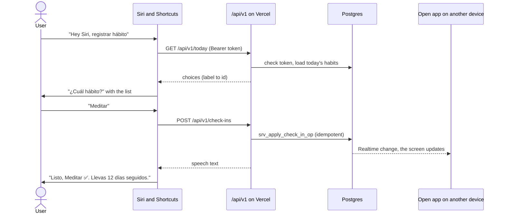

# 06 · Integrations

## 1. Siri and Shortcuts

### 1.1 How it works

A web app can't add commands to Siri. But Siri can run any **shortcut by saying its name**, and a shortcut can call an HTTPS API, show a list, and speak a reply. The app publishes ready-made shortcuts that call the [Shortcuts API](05-api.md#2-shortcuts-api-v1).



### 1.2 Distribution

- iOS only imports shortcuts that Apple has signed, so they're shared as **iCloud links**, one per language. The links and step-by-step recipes live in `shortcuts/`.
- When installing, an **Import Question** asks the user to paste their token. If a recipe can't use Import Questions, it starts with a *Text* action where the user pastes the token.
- A new version means new iCloud links. The app shows an update hint (see `X-Shortcut-Version` in [API §2](05-api.md#2-shortcuts-api-v1)).

### 1.3 Catalog

| Spanish name (Siri phrase) | English name (Siri phrase) | What it does | Endpoints |
|---|---|---|---|
| Registrar hábito | Log habit | Asks which pending habit, logs it, speaks the result | `GET /today`, `POST /check-ins` |
| Deshacer hábito | Undo habit | Undoes today's last check-in | `POST /check-ins/undo` |
| Cómo voy | How am I doing | Speaks score and what's left | `GET /summary` |
| Sincronizar Salud | Sync Health | Sends Health totals (run by automations) | `POST /health` |
| *Ya medité* (user-made copy) | *I meditated* (user-made copy) | Logs one habit directly, no question | `POST /check-ins` |

### 1.4 Recipe: "Log habit"

1. **Text** — the token (from the Import Question).
2. **Get Contents of URL** — `GET https://<app-domain>/api/v1/today`, header `Authorization: Bearer <Text>`, header `X-Shortcut-Version: 1.0`.
3. **Get Dictionary Value** `pending_count`. **If** it's 0 → **Show Result** with `speech`, then **Stop This Shortcut**.
4. **Get Dictionary Value** `choices` → **Choose from List** (prompt: "¿Cuál hábito?" / "Which habit?").
5. **Get Dictionary Value** of the chosen item from `choices` → the habit ID.
6. **Get Contents of URL** — `POST /api/v1/check-ins`, JSON body `{ "habit_id": <ID> }`, same headers.
7. **Get Dictionary Value** `speech` → **Show Result**. When the shortcut was started by voice, Siri reads it aloud.

**Per-habit copy** ("I meditated"): duplicate the shortcut, remove steps 2–5, and put the habit ID (copied from the habit's page in the app) in the body. The ID is used instead of the name so renaming the habit doesn't break it.

### 1.5 Quick access without voice

- **Home Screen widget:** the Shortcuts widget with "Log habit" gives one-tap logging. Web apps can't have their own widgets, so this is the replacement.
- **Action Button** (iPhone models that have it) and **Back Tap** (*Settings → Accessibility → Touch*) can run "Log habit".

### 1.6 Setup inside the app (`FR-SIR-1`)

*Settings → Siri & Shortcuts:* (1) create a token and copy it, (2) open the install link for your language, (3) paste the token, (4) say "Hey Siri, log habit". The page waits for the first API call with that token and then shows ✅ "Connected".

### 1.7 Limitations

- Only iPhone, iPad and Mac. Android and Windows users log from the app or from notification buttons.
- The token is stored in the user's shortcut. Revoking the token disables it immediately.
- Shortcuts don't retry automatically, so a network error is reported by Siri and the user retries. `op_id` makes retries safe.

## 2. Apple Health

### 2.1 How it works

Web apps can't read HealthKit. The **"Sync Health"** shortcut reads daily totals with *Find Health Samples* and sends them to `POST /api/v1/health`. The server applies the rules in `R-HLT`.

### 2.2 Metrics

| `health_metric` | Health data | Unit sent | Notes |
|---|---|---|---|
| `steps` | Steps | count | |
| `exercise_minutes` | Exercise Minutes | minutes | Good "workout day" signal |
| `active_energy_kcal` | Active Energy | kcal | |
| `distance_km` | Walking + Running Distance | km | |
| `mindful_minutes` | Mindful Minutes | minutes | |
| `workouts` | Workouts | count | **Spike S3:** confirm Shortcuts can read it. Fallback: `exercise_minutes ≥ N` |
| `sleep_hours` | Sleep (asleep) | hours | **Spike S3:** confirm, and assign the night to the date you wake up |

### 2.3 Recipe: "Sync Health"

For each metric that the user's habits use:

1. **Find Health Samples** of that type for **today**, and sum them.
2. The same for **yesterday** (to pick up data that arrived late, e.g. from an Apple Watch).
3. Add `{ "metric", "date", "value" }` to a list. Dates use **Format Date** with the custom format `yyyy-MM-dd`.

Then **Get Contents of URL** → `POST /api/v1/health` with `{ "metrics": [...] }`. When run by an automation, nothing is shown.

> **Spike S3 also checks** that the totals match the Health app. iPhone and Apple Watch can both record steps, and adding raw samples could count them twice. If so, use Shortcuts' grouping options or keep one source.

### 2.4 Automations (guided in the app)

*Shortcuts → Automation → Time of Day*, set to **Run Immediately** with notifications off. Suggested times:

- 12:00, 18:00 and 21:00;
- **15 minutes before the daily report**, so the report has fresh numbers.

The app shows the last sync time and warns if it's been more than 24 hours (`FR-HLT-3`).

### 2.5 Known limits

- **A locked iPhone may block Health reads.** Health data is protected while the device is locked, so an automation that runs while it's locked might fail. Several automations a day plus the "yesterday" backfill reduce the impact. Spike S3 measures it.
- Health data only exists on iPhone, so Health rules can't be evaluated for users without one. The rule form explains this.
- The "day" for Health is the calendar day (`R-HLT-2`).

## 3. Google Calendar

### 3.1 Why Google

Google Calendar has a REST API with OAuth and allows updating a single day of a recurring event. iCloud has no public API: only CalDAV with an app-specific password, which is hard to set up and fragile.

### 3.2 Google Cloud setup

- A Google Cloud project with the **Google Calendar API** enabled.
- OAuth consent screen (type *External*) with the app name (**Restart**), logo, support email, and links to the home page and privacy policy.
- An OAuth client of type *Web application*. Redirect URIs: `https://<app-domain>/api/calendar/google/callback`, plus preview and local URLs for development.
- **Scopes:** `https://www.googleapis.com/auth/calendar.app.created` (create secondary calendars and manage only the events in calendars the app created) plus `openid email` (to show which account is connected). The app never asks for access to the user's other calendars.

### 3.3 Verification: not needed for Restart

Google treats Calendar scopes as sensitive. Check the exact classification of `calendar.app.created` in the console when setting it up. Restart is for fewer than 100 people, so it **stays unverified**:

- Set the publishing status to **In production** without submitting for verification. Users see a "Google hasn't verified this app" screen once and continue with *Advanced → Go to Restart*. Unverified apps are limited to **100 users**, which is enough.
- Don't leave it in **Testing**: there, refresh tokens expire after **7 days**, so everyone would have to reconnect every week.
- If Restart ever opens to the public, verification needs a verified domain, home page, privacy policy, terms, a justification for each scope and a demo video, and review can take weeks.
- Confirm both behaviors (the warning screen and tokens that don't expire weekly) during spike S6, since Google may change them.

### 3.4 Connecting

1. `GET /api/calendar/google/connect` → redirect to Google with `access_type=offline`, `prompt=consent` and a `state` tied to the session.
2. The callback exchanges the code, encrypts and stores the refresh token, and creates the app's calendar: `calendars.insert({ summary: "Hábitos" | "Habits", timeZone: profile.timezone })`.
3. A `full_resync` job is queued to create events for every habit with `calendar_sync` on.

### 3.5 Event model

One **recurring event** per habit and schedule period (`calendar_series`):

| Field | Value |
|---|---|
| `summary` | Icon + habit name, e.g. "🧘 Meditar" |
| `description` | Cue, description, and a link to `https://<app-domain>/habits/<id>` |
| `start` / `end` | First occurrence at the habit's time, lasting `duration_min` (default 15), with the user's `timeZone` |
| `recurrence` | `RRULE:FREQ=DAILY` or `RRULE:FREQ=WEEKLY;BYDAY=MO,TU,TH,FR`, plus `EXDATE` for paused days |
| `reminders` | `{ "useDefault": false }`, so Google doesn't notify too (`FR-CAL-6`) |
| `transparency` | `transparent`, shown as "free" |
| `extendedProperties.private` | `{ "habitId": "<id>" }`, used to find events during a resync |

### 3.6 Sync operations

| Job | Triggered by | Google calls |
|---|---|---|
| `sync_series` | Habit created or `calendar_sync` turned on; schedule, time, routine time or pauses changed | First time: `events.insert`. Schedule or time change: patch the old series with `UNTIL` = yesterday and insert a new series from today (past events stay as they were). Pause change: patch `EXDATE` |
| `mark_instance` | Check-in done, skipped, undone or cleared | `events.instances` (time range of that day) → `events.patch` of that instance: "✅ Name" and a green color; "⏭️ Name" for skips; restore name and color on undo |
| `end_series` | Habit archived or `calendar_sync` turned off | Patch `UNTIL` = the day before |
| `delete_series` | Habit deleted | `events.delete` for each event ID in `payload` |
| `full_resync` | Connection, "Resync" button, or repair | Rebuild everything idempotently, using `extendedProperties` to find existing events |
| `delete_calendar` | Disconnect with "delete calendar" chosen | `calendars.delete` |

Only fixed-schedule habits with a time are synced (`FR-CAL-5`).

### 3.7 Worker rules

- Pending jobs for the same (habit, op, date) are **coalesced**: only the newest runs.
- **Backoff:** 1 min, 5 min, 30 min, 2 h, 12 h; marked `failed` after 6 attempts.
- **`invalid_grant` / 401:** the connection becomes `needs_reauth`, jobs wait, and the app shows a "Reconnect Google Calendar" banner.
- **403 rate limit / 5xx:** retried with backoff.
- **404 on an instance** (the user deleted it in Google): queue `sync_series` for that habit.
- **Disconnect:** revoke the token at `https://oauth2.googleapis.com/revoke`, delete the connection, and, if the user chose it, delete the calendar.
- **Latency:** a Siri check-in processes its calendar job right away with `after()`. Other jobs are processed by the next tick (≤ 1 min).

## 4. Web Push

### 4.1 Keys

A VAPID key pair is generated once (`npx web-push generate-vapid-keys`). The subject is `mailto:` plus the support email. The public key is sent to the client; the private key stays on the server.

### 4.2 Subscribing (`FR-NTF-1`, `FR-NTF-12`)

1. **iPhone:** if the app isn't installed (`display-mode` isn't `standalone`), show the install guide instead of asking for permission.
2. After a **tap** (user gesture): `Notification.requestPermission()` → `registration.pushManager.subscribe({ userVisibleOnly: true, applicationServerKey })` → `POST /api/push/subscriptions`.
3. Each time the app opens, compare the current subscription with the stored one and update it if it changed.

### 4.3 Sending

- `web-push` from the tick, with **TTL**: reminders 10 min, digests 30 min, reports 2 h, weekly review 12 h. **Urgency** `high` for reminders, `normal` for the rest.
- **404 / 410** → delete that subscription. **429 / 5xx** → retry in the next tick (at most 2 times). Other 4xx → log and mark `failed`.
- Each notification goes to every device of the user.

### 4.4 Payload

```json
{
  "v": 1,
  "kind": "habit_reminder",
  "title": "⏰ Meditar en 5 min",
  "body": "Después de preparar el café · 🔥 11 días",
  "tag": "habit:6f1c…:2026-10-20",
  "url": "/today?habit=6f1c…",
  "badge": 3,
  "actions": [
    { "action": "done", "title": "Hecho" },
    { "action": "snooze", "title": "15 min" }
  ],
  "actionToken": "eyJ…"
}
```

`tag` makes a newer notification replace the older one for the same habit and day. `actions` are ignored where buttons aren't supported (iPhone).

### 4.5 Service worker

- **`push`:** always call `showNotification` (iOS may cancel the subscription of an app that receives pushes without showing anything), then `navigator.setAppBadge(badge)`.
- **`notificationclick`:** with an action → `POST /api/notifications/action` with the token, then close. Without an action → focus an open window and go to `url`, or open a new one.

### 4.6 Messages

| Kind | Español | English |
|---|---|---|
| Habit reminder | **⏰ Meditar en 5 min** · Después de preparar el café · 🔥 11 días | **⏰ Meditate in 5 min** · After I brew coffee · 🔥 11 days |
| Routine digest | **🌅 Rutina de mañana · 4 hábitos** · Meditar, Leer, Agua, Estirar | **🌅 Morning routine · 4 habits** · Meditate, Read, Water, Stretch |
| Daily report | **📊 Hoy: 80% (8/10)** · 🔥 Meditar 12 días. Faltan: Leer, Diario | **📊 Today: 80% (8/10)** · 🔥 Meditate 12 days. Left: Read, Journal |
| Perfect day | **🎉 ¡Día perfecto! 100%** · ¿Cómo te sentiste hoy? | **🎉 Perfect day! 100%** · How did you feel today? |
| Weekly review | **🗓️ Tu semana: 76% (+6%)** · Toca para revisarla y planear la próxima | **🗓️ Your week: 76% (+6%)** · Tap to review it and plan the next one |

### 4.7 iPhone limitations

- Push only works for apps added to the Home Screen (iOS 16.4+). Permission can only be requested after a tap inside the installed app.
- No notification buttons. Tapping opens the habit.
- Focus modes and Low Power Mode can delay or hide notifications. The daily report acts as a safety net.
- Removing the app from the Home Screen ends the subscription (the server receives 410 and deletes it).
